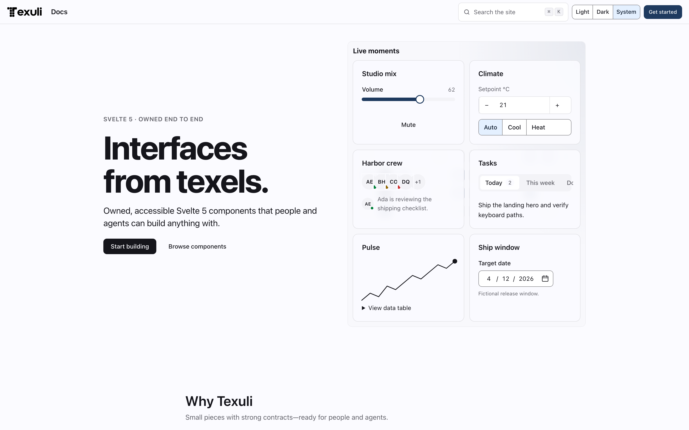

<div align="center">

<picture>
  <source media="(prefers-color-scheme: dark)" srcset="brand/texuli-logo-dark.png">
  
</picture>

# Texuli

### Small pieces. Build anything. Built for the agentic era.

[](LICENSE)
[](package.json)
[](docs/STANDARDS.md)
[](package.json)
[](docs/RELEASE.md)
[](https://www.dailybot.com?utm_source=dailybotopensource&utm_medium=texuli)

**Small pieces. Infinite possibilities.** Texuli is an open-source Svelte 5
component library, built from scratch and owned end to end. Framework-free
*texels* compose into accessible headless primitives; with the OKLCH theme
engine (a perceptual color space: lightness, chroma, hue) those become
styled components and whole interfaces — apps, dashboards, data views,
charts, media, chat, documents and slide decks.
Agents get a catalog whose output renders through a sink-free renderer, so
the same pieces are safe to hand to a machine.

[Quickstart](#60-second-start) ·
[The layers](#small-pieces-all-the-way-down) ·
[What you can build](#what-you-can-build) ·
[The Compose twin](#the-kotlin-multiplatform-twin) ·
[Built for agents](#built-for-agents) ·
[Quality](#measured-quality) ·
[Honest boundaries](#honest-boundaries) ·
[Docs](#documentation)



> **Status: in development, pre-1.0.** The screenshot above is the
> texuli.com website, which deploys from `main` to Cloudflare Pages. The 25
> published packages are released on npm in the 0.8 line: 16 at `0.8.0`, plus patch releases (`@texuli/slides` `0.8.2`; `0.8.1` for `@texuli/data`, `@texuli/blocks`, `@texuli/catalog`, `@texuli/pages`, `@texuli/player`, `@texuli/sheets`, `@texuli/tools` and `@texuli/astro`) (published by CI with
> provenance; `latest` and `next` point to the newest), including the first
> release of `@texuli/forms`, `@texuli/canvas` and `@texuli/sheets`. It is not a stable
> release: under 0.x a new minor may contain breaking changes, and 1.0.0 will
> be the first stable release. The workspace packages stay `private: true`
> ([RELEASE](docs/RELEASE.md)).

</div>

## Why

A UI built by an agent is only as good as the pieces it is allowed to use.
When components come from many places, nobody owns the focus order, the
dismissal behavior, the contrast math or what a link is allowed to point at —
and an agent writing markup into your app inherits every one of those gaps.

Texuli takes the opposite bet: **own every piece.** The overlay engine, the
roving focus, the positioning, the class helpers and the theme engine are
written here, held to the WAI-ARIA Authoring Practices, budgeted per export
subpath, and documented for people and agents alike. Small pieces, verified
one by one — so whatever you or your agents build on top is made of parts
that behave.

## 60-second start

You need Node.js 24.20 or newer and pnpm 11 (through Corepack).

```bash
git clone https://github.com/DailybotHQ/texuli
cd texuli
corepack enable && pnpm install
```

Then:

```bash
pnpm check     # lint, typecheck, unit and component tests, layer guard
pnpm dev       # the texuli.com website → http://localhost:4321
```

The website is the whole product surface: the docs, a live demo of every
component, 200+ themes to explore, and the live builder that composes
interfaces from the catalog.

## Small pieces, all the way down

Every layer is a package with one job, and every dependency points down only
([ARCHITECTURE](docs/ARCHITECTURE.md)).

| Layer | Package | The small pieces |
| --- | --- | --- |
| L0 | [`@texuli/core`](packages/core/README.md) | **Texels**: framework-free behavior and policy — the overlay engine, roving focus, positioning, ids, the two-tier URL policy |
| L0 | [`@texuli/date`](packages/date/README.md) | Dependency-free Gregorian calendar dates behind the calendar and date pickers |
| L0 | [`@texuli/drag`](packages/drag/README.md) | The framework-free drag engine: sortable lists, trees, canvas and graph editing, with moves planned as data (in development) |
| L0 | [`@texuli/deck`](packages/deck/README.md) | The framework-free deck engine: deck model v2 from JSON or Markdown, layouts, navigation and lint (in development) |
| L0 | [`@texuli/spec`](packages/spec/README.md) | The schema-first blueprint contract, with TypeScript and Kotlin projections |
| L1 | [`@texuli/primitives`](packages/primitives/README.md) | 41 owned headless primitives, one subpath each, held to the APG patterns |
| L1 | [`@texuli/document`](packages/document/README.md) | The framework-free block document engine: model, operations, Markdown, pagination, DOCX and PDF, CRDT sync (in development) |
| L2 | [`@texuli/tokens`](packages/tokens/README.md) | The OKLCH theme engine, the `--tx-*` token contract, 200+ themes, compiled CSS |
| L3 | [`texuli`](packages/texuli/README.md) | Styled components, icons, layouts and app shells |
| L4 | [`@texuli/data`](packages/data/README.md) · [`@texuli/charts`](packages/charts/README.md) · [`@texuli/media`](packages/media/README.md) · [`@texuli/chat`](packages/chat/README.md) · [`@texuli/workflows`](packages/workflows/README.md) · [`@texuli/editor`](packages/editor/README.md) · [`@texuli/forms`](packages/forms/README.md) · [`@texuli/canvas`](packages/canvas/README.md) | Domain packages: data views, every chart family, media, chat, workflow graphs (in development), the rich text editor (in development), schema-driven forms (in development), the infinite canvas (in development) |
| L5 | [`@texuli/blocks`](packages/blocks/README.md) · [`@texuli/sheets`](packages/sheets/README.md) | Content blocks for pages, documents and slides; spreadsheets with an owned formula engine (in development) |
| L6 | [`@texuli/catalog`](packages/catalog/README.md) | The agent catalog and its sink-free renderer |
| L7 | [`@texuli/player`](packages/player/README.md) | The runtime that paints validated blueprints |
| L8 | [`@texuli/tools`](packages/tools/README.md) · [`@texuli/astro`](packages/astro/README.md) · [`@texuli/slides`](packages/slides/README.md) · [`@texuli/pages`](packages/pages/README.md) | The copy-in CLI, LLM docs, the A2UI adapter, custom elements, the MCP server; the Astro integration; the slide stage on `@texuli/deck`; the block document editor and reader (in development) |

The layer graph is enforced, not aspirational: `pnpm check:layers` fails any
import that points up.

## What you can build

| Family | What you get |
| --- | --- |
| **Components** | Buttons, fields, choices, overlays, navigation, tables of content — styled components and layouts that theme through the `--tx-*` contract |
| **Data** | Grid, tree, board, calendar, timeline, map and files: dense product surfaces with keyboard access |
| **Charts** | Every chart family on Texuli's own chart math — one subpath each, no third-party chart code |
| **Media** | Images, galleries, video, audio and editors, with compositions that keep their layout while media resolves |
| **Chat** | Threads, messages and composers for conversational products |
| **Documents & decks** | Content blocks that compose into pages, long documents and slide decks with a full keyboard map |

Every example in [`@texuli/examples`](packages/examples/README.md) is a
registered fixture: it runs in unit tests, visual baselines, accessibility
sweeps and the website.

## The Kotlin Multiplatform twin

The same interfaces render beyond the web. [`native/`](native/README.md) is a
self-contained Gradle Kotlin Multiplatform build that consumes the blueprint
contract from [`@texuli/spec`](packages/spec/README.md) — it never imports
TypeScript or Svelte — and paints it with Compose.

| Module | What it holds | Targets |
| --- | --- | --- |
| `texuli-spec` | Generated models, enums and decoders from the same spec codegen, the strict JSON reader, the validator (the twin of the web's `validateBlueprint`), the render plan and its tier gate | JVM, iOS (arm64 + simulator) |
| `texuli-compose` | The token theme (`TexuliTheme`), the native registry, typed host intents, and Compose components: page, document, deck, card and bounded grid layouts, text blocks and lists, tables, static boards, media frames and a compact-chart slice | JVM (Compose Desktop) |
| `conformance` | The native half of the dual-target golden gate and the KMP app migration checks | JVM tests |

**One spec, two targets.** The golden gate is semantic, not pixel: every spec
golden loads on the web and natively, and the native trace must equal the web
trace — roles, accessible names, heading levels. Invalid blueprints are
refused with exactly the TypeScript validator's codes. The same two-tier URL
policy runs in common Kotlin, and a hostile-props matrix (wrong types,
depth bombs, bidi, huge and deep containers) proves every projection stays
in bounds and never throws. Anything the twin cannot paint yet becomes a
visible placeholder, never a silent drop.

Six real KMP test-bench apps are pinned by migration checks — a starter, a
todo list, an AI chat, a voice chat, a live-room dynamics app and a duel
game — each mapped to blueprints with every widget's status documented.

**Status: in development, nothing published.** App-shell layouts and most
chart families are still placeholders; media frames paint their aspect,
caption and alt but no pixels yet, and video shows its poster. iOS compiles
`texuli-spec` today (for a SwiftUI adapter); Android waits on a design
decision — and the web stays Svelte.

## Built for agents

Texuli is designed to be built *by* agents as much as by people.

| Surface | What it gives an agent | Read |
| --- | --- | --- |
| **Agent skill** | A distributable skill pack (`skills/texuli/`) that installs into Claude Code, Codex, Cursor and other hosts — pinned, checksum-verified, checked by `pnpm check:skill` | [Skill](skills/texuli/SKILL.md) |
| **Agent catalog** | A declarative catalog of components and props. An agent emits catalog nodes; the renderer turns them into real components | [Catalog](packages/catalog/README.md) |
| **No HTML sinks** | Never `{@html}`, `innerHTML`, `eval` or `new Function` on props, content or agent output. Structure is trusted; markup never is | [Security](docs/SECURITY.md) |
| **Two-tier URL policy** | Every link and media source passes `safeHref` / `safeMediaSrc`: `developer` for app-authored props, `untrusted` for agent and user content | [URL policy](docs/SECURITY.md) |
| **MCP server** | A local stdio MCP server over the tools package — no hosted endpoint | [Tools](packages/tools/README.md) |
| **LLM docs & A2UI** | Docs generated for LLM consumption and an A2UI adapter for agent-to-UI flows | [Tools](packages/tools/README.md) |

Inside the repository, [AGENTS.md](AGENTS.md) is the single entry point for
every coding agent (CLAUDE.md links to it): the rules, the doc index, and
every verified command.

## Measured quality

- **1,551 unit and component tests** after the 2026-10-27 lean-suite trim
  (one suite, the same locally and in CI), plus a behavior suite per
  primitive on Chromium and WebKit, with touch rows on a Pixel 7 viewport
  ([TESTING_GUIDE](docs/TESTING_GUIDE.md)).
- **axe with zero exclusions** in light, dark and forced colors, with
  keyboard walks, RTL layouts and reduced motion on every example
  ([ACCESSIBILITY](docs/ACCESSIBILITY.md)).
- **A gzip budget for every export subpath** (`pnpm size`), and visual
  baselines in light/dark on desktop and mobile ([PERFORMANCE](docs/PERFORMANCE.md)).
- **Strict, erasable TypeScript** and Biome across the workspace; packages
  export their TS source.
- **A dual-target conformance gate.** The Compose twin must reproduce the
  web's semantic traces and refusal codes for every spec golden
  (`./native/gradlew -p native check` on JDK 21; a local gate, not in CI).
- **A threat model that is tested, not just written** — hostile inputs ship
  as fixtures in the suites ([SECURITY](docs/SECURITY.md)).

## Honest boundaries

- **No stable release yet.** The 25 published packages are on npm as
  `0.8.0`, a pre-1.0 release (`npm install texuli`; `latest` and `next` both
  point to it). Under 0.x a new minor (`0.9.0`) may contain breaking changes,
  so pin the exact version or use `^0.8.0`; 1.0.0 will be the first stable
  release.
  The workspace packages stay `private: true` ([RELEASE](docs/RELEASE.md)).
- **texuli.com deploys from `main`** (Cloudflare Pages). Run it locally with
  `pnpm dev`.
- **Web first, native in progress.** The Compose twin (see
  [above](#the-kotlin-multiplatform-twin)) renders a real slice with visible
  placeholders for the rest; nothing native is published and Android waits on
  a design decision.
- **Verified where it counts, not everywhere.** See what the gates do and do
  not cover in [TESTING_GUIDE](docs/TESTING_GUIDE.md).

## Commands

```bash
pnpm install | dev | build | lint | typecheck | test | check
pnpm test:e2e | visual | size | verify:packages | check:skill | test:perf
```

Every root and package script, with scoped variants, is in
[DEVELOPMENT_COMMANDS](docs/DEVELOPMENT_COMMANDS.md). Browser checks need
Playwright browsers once (`pnpm test:e2e:install`).

## Documentation

| Understand | Build | Verify | Ship |
| --- | --- | --- | --- |
| [Product spec](docs/PRODUCT_SPEC.md) | [Architecture](docs/ARCHITECTURE.md) | [Testing guide](docs/TESTING_GUIDE.md) | [Release](docs/RELEASE.md) |
| [Decisions](docs/DECISIONS.md) | [Standards](docs/STANDARDS.md) | [Accessibility](docs/ACCESSIBILITY.md) | [Security](docs/SECURITY.md) |
| [Agent onboarding](docs/AI_AGENT_ONBOARDING.md) | [Development commands](docs/DEVELOPMENT_COMMANDS.md) | [Performance](docs/PERFORMANCE.md) | [Quality reports](docs/README.md#quality-reports-docsquality) |

The full index is [docs/README.md](docs/README.md). Every package also has
its own `README.md` describing every subpath.

## Contributing

Read [AGENTS.md](AGENTS.md) first — it holds the rules every contributor
(human or agent) works under: English only, Conventional Commits with exact
paths, owned primitives, no HTML sinks, and validation that follows the
touched surface. Before a pull request:

```bash
pnpm check                              # lint + typecheck + unit and component tests
pnpm test:e2e                           # browser checks on the touched specs
```

The source-to-test map for choosing the right gates is in
[TESTING_GUIDE](docs/TESTING_GUIDE.md).

## License

[MIT license](LICENSE) © Dailybot, Inc., maintained by [Dailybot](https://www.dailybot.com?utm_source=dailybotopensource&utm_medium=texuli).
